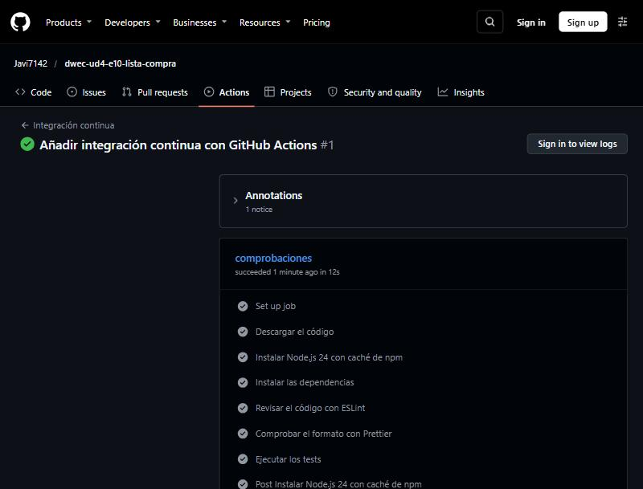
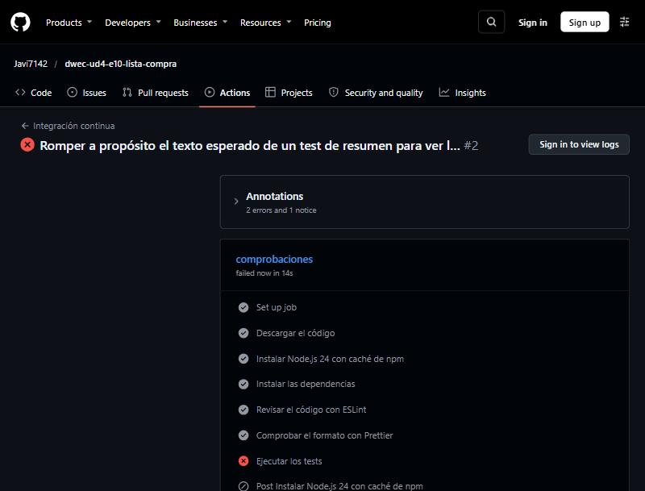

# Lista de la compra

Repositorio del ejercicio: <https://github.com/Javi7142/dwec-ud4-e10-lista-compra>

## Cómo ejecutarlo

**La página.** Abro en VS Code la carpeta del ejercicio (`E10-ListaCompra`, la que contiene `.devcontainer/`) y ejecuto **Dev Containers: Reopen in Container**. Al conectarse, el contenedor instala las dependencias, arranca el servidor (`npx serve@14.2.6 --listen 3410 .`) y reenvía el puerto 3410: la página se ve en <http://localhost:3410/>. Al ser una página web, no hay `npm start`.

**Tests, ESLint y Prettier**, en la terminal del contenedor:

```bash
npm test               # tests con Vitest
npm run lint           # ESLint
npm run format:check   # comprueba el formato con Prettier (npm run format lo corrige)
```

## Módulos

| Módulo | Responsabilidad | ¿Usa el navegador? |
|--------|-----------------|:------------------:|
| `src/lista.js` | Operaciones sobre la lista (añadir, marcar, quitar, ordenar, resumir). Cada una recibe la lista y devuelve una nueva | No |
| `src/almacen.js` | Guardar y cargar la lista como JSON con versión (recibe el almacenamiento como parámetro) | No (el almacén se inyecta; por defecto, `localStorage`) |
| `src/vista.js` | Generar el HTML de la lista, escapar textos, «hace X minutos» y el título de la pestaña | No |
| `src/compartir.js` | Construir y leer el enlace para compartir con `URL` y `URLSearchParams` | No |
| `src/dialogos.js` | Confirmaciones con `<dialog>` y avisos en la zona de avisos | **Sí** (DOM) |
| `src/sincronizar.js` | Avisar a otras pestañas y escuchar sus cambios (`BroadcastChannel` o `storage`) | **Sí** (canales y eventos) |
| `src/main.js` | Une todo: estado, eventos, tema, enlace compartido y repintado | **Sí** (DOM, `location`, `history`, `navigator`, `matchMedia`) |

**Por qué separo las funciones puras de las que usan el navegador.** Las funciones puras (`lista`, `almacen`, `vista`, `compartir`) solo dependen de sus parámetros, y todo lo que cambia (la fecha actual, el almacenamiento) se recibe como parámetro con un valor por defecto. Eso permite probarlas con Vitest en Node.js, sin navegador, con un almacenamiento falso y con el reloj fijado, y entenderlas sin conocer la página. Lo que toca el DOM, `location`, los canales o las ventanas (`dialogos`, `sincronizar`, `main`) queda aislado en tres ficheros pequeños que apenas contienen lógica: `main.js` solo conecta los eventos con las funciones puras.

## Objetos predefinidos

| Objeto | Dónde | Para qué |
|--------|-------|----------|
| `Intl.Collator('es', { sensitivity: 'base' })` | `lista.js` | Comparar nombres sin distinguir mayúsculas ni tildes (`Café` = `CAFE`, pero `Año` ≠ `Ano`) y ordenarlos con las reglas del español (`Árbol` con la A, `Ñu` después de la N) |
| `Intl.PluralRules('es')` | `lista.js` | Elegir «artículo/artículos» y «comprado/comprados» |
| `Intl.RelativeTimeFormat('es-ES', { numeric: 'auto' })` | `vista.js` | «ahora», «hace 5 minutos», «hace 2 horas», «ayer», «anteayer» |
| `Date` | `lista.js`, `almacen.js`, `vista.js` | La fecha de cada artículo (`creado`); `new Date(texto)` y `getTime()` para convertir y validar la fecha leída del JSON |
| `JSON.stringify` / `JSON.parse` | `almacen.js` | Guardar y leer la lista (las fechas se guardan como texto ISO) |
| `String` (`trim`, `replace`, `split`, `slice`, `lastIndexOf`) y `Number`, `Math` | varios | Limpiar nombres, escapar HTML, interpretar `nombre*cantidad` y validar enteros (`Number.isInteger`) |
| `crypto.randomUUID()` | `lista.js` | El `id` de cada artículo |
| `URL` y `URLSearchParams` | `compartir.js`, `main.js` | Construir el enlace (`searchParams.set`), leerlo y quitar el parámetro de la URL |
| `location` (`origin`, `pathname`, `search`, `href`) | `main.js` | La base del enlace de compartir y los parámetros que trae la página |
| `history.replaceState` | `main.js` | Quitar `?compartir=…` de la URL sin recargar y sin añadir una entrada al historial |
| `document.title` | `main.js` | El título de la pestaña con los pendientes: `(2) Lista de la compra` |
| `matchMedia('(prefers-color-scheme: dark)')` | `main.js` | El tema del sistema y sus cambios |
| `document.documentElement.dataset.tema` | `main.js` | Cambiar el tema con el atributo `data-tema` (los colores los pone el CSS) |
| `navigator.clipboard` | `main.js` | Copiar el enlace (se detecta con `'clipboard' in navigator`; si no está, se muestra en un aviso) |
| `localStorage` y el evento `storage` | `almacen.js`, `sincronizar.js` | Guardar la lista y, sin `BroadcastChannel`, enterarse de los cambios de otras pestañas |
| `BroadcastChannel` | `sincronizar.js` | Avisar a otras pestañas (se detecta con `'BroadcastChannel' in globalThis`) |
| `<dialog>` (`showModal`, `returnValue`, evento `close`) | `dialogos.js` | La confirmación de quitar |
| `setTimeout` / `clearTimeout` y `setInterval` | `dialogos.js`, `main.js` | Borrar los avisos pasado un tiempo y repintar cada minuto los «hace X» |

## Qué se guarda y dónde

| | |
|---|---|
| **Dónde** | `localStorage`, clave `lista-compra` |
| **Formato** | JSON `{ "version": 1, "articulos": [ { "id", "nombre", "cantidad", "comprado", "creado" } ] }`, con `creado` como texto ISO (se convierte de nuevo en `Date` al cargar) |
| **Por qué ese mecanismo** | Es un dato que solo necesita esta página, debe sobrevivir a cerrar el navegador y no debe viajar al servidor en cada petición (una cookie lo haría). `localStorage` además avisa a las otras pestañas con el evento `storage` |
| **Si está corrupto** | `cargar` captura el error de `JSON.parse` y devuelve `[]`: la página arranca con la lista vacía en vez de romperse. La clave rota **no se borra** hasta que el usuario cambia la lista (entonces `guardar` la sobrescribe) |
| **Si es de otra versión** | `cargar` devuelve `[]` (`version` distinta de 1, o ausente) y la página arranca vacía. La versión permite cambiar el formato en el futuro sin interpretar datos viejos como si fueran nuevos |
| **Si un artículo tiene datos incorrectos** | Se descarta ese artículo y se conservan los válidos (`id` y `nombre` no vacíos, `cantidad` entera entre 1 y 99, `comprado` booleano y `creado` con una fecha válida) |
| **Si no se puede guardar** | `guardar` devuelve `false` (almacenamiento lleno o bloqueado) y `main.js` muestra el aviso `⚠️ No se ha podido guardar la lista en este navegador` |

## Varias pestañas

**Mecanismo.** `sincronizar.js` usa un **`BroadcastChannel`** llamado `lista-compra`: cuando una pestaña cambia la lista (`cambiar` en `main.js`), después de guardarla llama a `avisarCambio()`, que publica un mensaje; las demás pestañas lo reciben en `escucharCambios`, vuelven a cargar la lista con `cargar()` y repintan. (La pestaña que envía no recibe su propio mensaje.)

**Alternativa.** Si el navegador no tiene `BroadcastChannel` (se detecta con `'BroadcastChannel' in globalThis`), se usa el evento **`storage`** de `window`: el navegador lo lanza en las **otras** pestañas del mismo origen cada vez que una cambia `localStorage`. Se filtra `evento.key === 'lista-compra'`. En ese caso `avisarCambio()` no hace nada, porque guardar ya provoca el evento.

**Cómo lo probé** (con Chrome, dos pestañas reales sobre <http://localhost:3410/>):

- Con las dos abiertas, **marqué «Café» como comprado en la pestaña A**: la pestaña B, **sin recargar** (dejé una marca en `window` que seguía ahí), cambió sola: el título pasó a `(2) Lista de la compra`, el resumen a `3 artículos · 1 comprado` y Café bajó al final con la clase `comprado`.
- **Quité «Zumo»** (Aceptar en la confirmación) en A: desapareció de B, y el título de las dos pasó a `(1) Lista de la compra`.
- **Alternativa:** abrí una pestaña con un `<script>` previo que ejecuta `delete globalThis.BroadcastChannel` (una página de prueba temporal, que borré después) para que `sincronizar.js` use `storage`. Marqué «leche» en la otra pestaña (que sí usaba el canal y además guardaba en `localStorage`): la pestaña sin `BroadcastChannel` se actualizó sola (`(3) Lista de la compra`, `4 artículos · 1 comprado`) sin recargar.

## Seguridad

Los datos del usuario (el nombre de los artículos, y el nombre que trae un enlace compartido) entran en la página por **tres sitios**:

1. **`htmlLista` → `lista.innerHTML`.** Es el único sitio donde se genera HTML a partir de datos del usuario. Cada texto que se inserta pasa por `escaparHTML` (que cambia `& < > " '`): el nombre, el `id` y el texto «hace X», incluso los que van dentro de atributos (`data-id`, `aria-label`), para que unas comillas no «salgan» del atributo. Lo comprobé escribiendo el producto `<b>Pan</b>`: se ve el texto con las etiquetas, sin negrita, y no hay ningún elemento `<b>` en la lista (tampoco con ``, que tiene un test). Un ataque de XSS necesitaría que el nombre se insertara sin escapar.
2. **`textContent`** para todo lo demás: la pregunta de confirmación (`¿Quitar «<b>Pan</b>»?`), los avisos, el resumen y el texto de los mensajes de error. No interpreta HTML, así que no hace falta escapar.
3. **El enlace compartido (`?compartir=…`).** Viene de la URL, que escribe cualquiera: `leerCompartidos` descarta los trozos sin nombre y las cantidades que no son enteros entre 1 y 99, y los nombres que pasan van después a `anadir` y, al pintarlos, a `escaparHTML` como cualquier otro. Una URL como `?compartir=*2` solo produce un artículo con ese texto, que se escapa al pintarlo (lo cubren los tests de `leerCompartidos` y de `htmlLista`).

Además, no hay ningún `alert`, `confirm` ni `prompt` en el proyecto, y los datos leídos de `localStorage` se validan antes de usarse (`cargar` descarta lo que no tenga la forma esperada), porque ese almacenamiento también se puede editar a mano.

## Pruebas

**1. Salida de `npm test`** (con `npx vitest run --reporter=verbose`, que muestra el nombre de cada test):

```text

 RUN  v5.0.5 /w

 ✓ guardar y cargar > guarda la lista con la versión en la clave «lista-compra» 2ms
 ✓ guardar y cargar > guarda las fechas como texto ISO 0ms
 ✓ guardar y cargar > vuelve a cargar lo guardado, con las fechas convertidas de nuevo en Date 1ms
 ✓ guardar y cargar > guarda y carga una lista vacía 0ms
 ✓ guardar y cargar > devuelve [] si no hay nada guardado 0ms
 ✓ guardar y cargar > devuelve [] si el valor guardado está roto o no tiene la forma esperada ({no es json) 0ms
 ✓ guardar y cargar > devuelve [] si el valor guardado está roto o no tiene la forma esperada (null) 0ms
 ✓ guardar y cargar > devuelve [] si el valor guardado está roto o no tiene la forma esperada ("texto") 0ms
 ✓ guardar y cargar > devuelve [] si el valor guardado está roto o no tiene la forma esperada (42) 0ms
 ✓ guardar y cargar > devuelve [] si el valor guardado está roto o no tiene la forma esperada ([]) 0ms
 ✓ guardar y cargar > devuelve [] si es de otra versión, aunque los artículos sean válidos 0ms
 ✓ guardar y cargar > devuelve [] si «articulos» no es un array 0ms
 ✓ guardar y cargar > descarta los artículos con datos incorrectos y conserva los válidos 0ms
 ✓ guardar y cargar > acepta las cantidades límite 1 y 99 0ms
 ✓ guardar y cargar > devuelve [] si el almacenamiento lanza un error al leer 1ms
 ✓ guardar y cargar > guardar devuelve false si el almacenamiento está lleno 0ms
 ✓ escaparHTML > escapa los cinco caracteres especiales 1ms
 ✓ escaparHTML > escapa un nombre con etiquetas 0ms
 ✓ escaparHTML > escapa primero el & (no escapa dos veces) 0ms
 ✓ escaparHTML > no cambia un texto sin caracteres especiales, con tildes y emoji 0ms
 ✓ escaparHTML > devuelve una cadena vacía con una cadena vacía 0ms
 ✓ escaparHTML > convierte en texto lo que no lo es 0ms
 ✓ haceCuanto > con 0 ms de diferencia dice «ahora» 14ms
 ✓ haceCuanto > con 30000 ms de diferencia dice «ahora» 0ms
 ✓ haceCuanto > con 59999 ms de diferencia dice «ahora» 0ms
 ✓ haceCuanto > con 60000 ms de diferencia dice «hace 1 minuto» 0ms
 ✓ haceCuanto > con 300000 ms de diferencia dice «hace 5 minutos» 0ms
 ✓ haceCuanto > con 3540000 ms de diferencia dice «hace 59 minutos» 0ms
 ✓ haceCuanto > con 3599999 ms de diferencia dice «hace 59 minutos» 0ms
 ✓ haceCuanto > con 3600000 ms de diferencia dice «hace 1 hora» 0ms
 ✓ haceCuanto > con 7200000 ms de diferencia dice «hace 2 horas» 0ms
 ✓ haceCuanto > con 86340000 ms de diferencia dice «hace 23 horas» 0ms
 ✓ haceCuanto > con 86400000 ms de diferencia dice «ayer» 0ms
 ✓ haceCuanto > con 104400000 ms de diferencia dice «ayer» 0ms
 ✓ haceCuanto > con 172800000 ms de diferencia dice «anteayer» 0ms
 ✓ haceCuanto > con 259200000 ms de diferencia dice «hace 3 días» 0ms
 ✓ haceCuanto > con 3456000000 ms de diferencia dice «hace 40 días» 0ms
 ✓ haceCuanto > dice «ahora» con una fecha futura 0ms
 ✓ haceCuanto > usa la fecha actual por defecto 0ms
 ✓ htmlLista > devuelve una cadena vacía con la lista vacía 0ms
 ✓ htmlLista > genera un <li data-id> por artículo, en el orden recibido 1ms
 ✓ htmlLista > incluye la casilla .marcar, el nombre, la cantidad, cuándo se añadió y el botón .quitar 0ms
 ✓ htmlLista > un artículo pendiente no lleva la clase comprado ni la casilla marcada 0ms
 ✓ htmlLista > un artículo comprado lleva la clase comprado y la casilla marcada 0ms
 ✓ htmlLista > escapa un nombre con etiquetas: no se genera ninguna etiqueta nueva 0ms
 ✓ htmlLista > escapa las comillas del nombre y del id, que van dentro de atributos 0ms
 ✓ htmlLista > usa la fecha actual por defecto para el «hace X» 0ms
 ✓ tituloPestana > cuenta los pendientes entre paréntesis 0ms
 ✓ tituloPestana > con un solo pendiente dice (1) 0ms
 ✓ tituloPestana > con todo comprado muestra la marca de verificación 0ms
 ✓ tituloPestana > con la lista vacía también muestra la marca de verificación 0ms
 ✓ enlaceCompartir > pone los pendientes en el parámetro compartir como nombre*cantidad, separados por comas (que searchParams codifica como %2C) 1ms
 ✓ enlaceCompartir > codifica las tildes, los espacios y el & del nombre 0ms
 ✓ enlaceCompartir > deja fuera los artículos comprados 0ms
 ✓ enlaceCompartir > con la lista vacía o sin pendientes devuelve la base sin parámetro 0ms
 ✓ enlaceCompartir > cambia por un espacio las comas y los asteriscos del nombre, que romperían el formato 1ms
 ✓ enlaceCompartir > respeta otros parámetros de la base cambiando solo compartir 0ms
 ✓ enlaceCompartir > lanza un error si la base no es una URL válida 0ms
 ✓ leerCompartidos > lee nombre*cantidad separados por comas 0ms
 ✓ leerCompartidos > sin cantidad, es 1 0ms
 ✓ leerCompartidos > ignora los trozos vacíos y las cantidades que no son válidas 0ms
 ✓ leerCompartidos > descarta una cantidad no válida como «pan*0» 0ms
 ✓ leerCompartidos > descarta una cantidad no válida como «pan*100» 0ms
 ✓ leerCompartidos > descarta una cantidad no válida como «pan*-2» 0ms
 ✓ leerCompartidos > descarta una cantidad no válida como «pan*1.5» 0ms
 ✓ leerCompartidos > descarta una cantidad no válida como «pan*abc» 0ms
 ✓ leerCompartidos > descarta una cantidad no válida como «pan*» 0ms
 ✓ leerCompartidos > descarta una cantidad no válida como «pan*3x» 0ms
 ✓ leerCompartidos > acepta las cantidades límite 1 y 99 0ms
 ✓ leerCompartidos > ignora un trozo sin nombre, como «*3» 0ms
 ✓ leerCompartidos > devuelve [] si no hay parámetro compartir o está vacío 0ms
 ✓ leerCompartidos > decodifica las tildes, el + y el %26 de un enlace generado 0ms
 ✓ leerCompartidos > quita los espacios de los extremos de cada nombre 0ms
 ✓ leerCompartidos > es la inversa de enlaceCompartir para los artículos pendientes 0ms
 ✓ anadir > añade un artículo nuevo, pendiente, con la cantidad y la fecha indicadas 5ms
 ✓ anadir > quita los espacios de los extremos del nombre 0ms
 ✓ anadir > usa cantidad 1 por defecto 0ms
 ✓ anadir > usa la fecha actual por defecto (con el reloj fijado) 1ms
 ✓ anadir > genera un id distinto para cada artículo 0ms
 ✓ anadir > usa crypto.randomUUID para el id (espía comprobado con vi.fn) 1ms
 ✓ anadir > no modifica la lista recibida 0ms
 ✓ anadir > «Café» y «CAFE» son el mismo artículo: se suman 0ms
 ✓ anadir > «café» y «Cafe» son el mismo artículo: se suman 0ms
 ✓ anadir > «CAFÉ» y «cafe» son el mismo artículo: se suman 0ms
 ✓ anadir > «Pan» y «pAN» son el mismo artículo: se suman 0ms
 ✓ anadir > distingue artículos que solo se parecen (ñ no es n) 0ms
 ✓ anadir > al sumar a uno ya comprado, lo deja pendiente 0ms
 ✓ anadir > la cantidad se queda en el máximo de 99 0ms
 ✓ anadir > acepta justo la cantidad máxima, 99, y la mínima, 1 0ms
 ✓ anadir > rechaza un nombre vacío o solo con espacios 0ms
 ✓ anadir > rechaza la cantidad no válida 0 con un RangeError 0ms
 ✓ anadir > rechaza la cantidad no válida -1 con un RangeError 1ms
 ✓ anadir > rechaza la cantidad no válida 100 con un RangeError 0ms
 ✓ anadir > rechaza la cantidad no válida 1.5 con un RangeError 0ms
 ✓ anadir > rechaza la cantidad no válida NaN con un RangeError 0ms
 ✓ anadir > rechaza la cantidad no válida 2 con un RangeError 0ms
 ✓ anadir > rechaza la cantidad no válida null con un RangeError 0ms
 ✓ alternarComprado > marca un artículo pendiente como comprado y al revés 0ms
 ✓ alternarComprado > solo cambia el artículo con ese id 0ms
 ✓ alternarComprado > con un id que no existe devuelve una lista igual 0ms
 ✓ alternarComprado > no modifica la lista ni el artículo recibidos 0ms
 ✓ quitar y quitarComprados > quita el artículo con ese id 0ms
 ✓ quitar y quitarComprados > con un id que no existe no quita nada, pero devuelve una lista nueva 0ms
 ✓ quitar y quitarComprados > quita todos los comprados y deja los pendientes 0ms
 ✓ quitar y quitarComprados > quitarComprados con la lista vacía o sin comprados no cambia nada 0ms
 ✓ quitar y quitarComprados > no modifican la lista recibida 0ms
 ✓ ordenar > pone primero los pendientes y después los comprados 0ms
 ✓ ordenar > ordena por nombre según el español: «Árbol» va con la A y «Ñu» después de la N 0ms
 ✓ ordenar > no distingue mayúsculas al ordenar 0ms
 ✓ ordenar > con la lista vacía devuelve una lista vacía 0ms
 ✓ ordenar > no modifica la lista recibida (devuelve una copia) 0ms
 ✓ resumen > avisa de que la lista está vacía 0ms
 ✓ resumen > usa el singular con un artículo y ningún comprado 0ms
 ✓ resumen > usa el plural de artículos y el singular de comprado 0ms
 ✓ resumen > usa el plural en los dos con varios comprados 0ms
 ✓ resumen > cuenta artículos, no unidades (una línea con cantidad 5 es un artículo) 0ms

 Test Files  4 passed (4)
      Tests  116 passed (116)
   Start at  14:53:25
   Duration  383ms (import 50%, transform 23%, tests 15%, worker 12%)

```

**2. Dobles de prueba y mocks.**

- **`AlmacenFalso`** (`tests/AlmacenFalso.js`): un `localStorage` en memoria con `getItem`, `setItem`, `removeItem` y `clear`. Los tests de `almacen.js` lo usan para guardar y cargar sin navegador; cada test crea el suyo con `beforeEach`, así que no se contaminan entre sí.
- **`vi.fn()`**: almacenes «rotos» a mano, cuyo `getItem` lanza un error («bloqueado») o cuyo `setItem` lanza `QuotaExceededError`, para comprobar que `cargar` devuelve `[]` y que `guardar` devuelve `false`. Con `toHaveBeenCalledWith` y `toHaveBeenCalledTimes` se comprueba que se intentó leer la clave `lista-compra`.
- **`vi.spyOn(crypto, 'randomUUID')`** con `mockReturnValue('id-fijo')`: para que el `id` de un artículo sea predecible y comprobar que `anadir` lo pide una vez. Se deshace con `vi.restoreAllMocks()` en un `afterEach`.
- **`vi.useFakeTimers()` y `vi.setSystemTime()`**: fijan el reloj para probar que `anadir` usa la fecha actual por defecto (con `vi.useRealTimers()` en el `afterEach`). Los tests de `haceCuanto` y `htmlLista` pasan la fecha como parámetro con una constante, `AHORA`.

**3. Casos límite por módulo.**

- **`lista.js`**: cantidad 1 y 99 (válidas), 0, −1, 100, 1.5, `NaN`, `'2'` y `null` (no válidas, `RangeError`); nombre vacío o con solo espacios; **sumar con tope de 99** (98 + 5 = 99); `Café`, `café`, `CAFÉ` y `CAFE` como el mismo artículo (y `Año` ≠ `Ano`); sumar a uno comprado lo deja pendiente; la lista recibida no se modifica en ninguna función (`structuredClone` antes y después); ordenar con `Árbol`, `Ñu` y mayúsculas; id que no existe; lista vacía; resumen con singular y plural.
- **`almacen.js`**: ida y vuelta de `guardar` y `cargar` con las fechas como `Date`; lista vacía; nada guardado; JSON roto, `null`, `[]`, un texto y un número; otra versión y sin versión; `articulos` que no es un array; **15 artículos incorrectos** (sin id, nombre vacío, cantidad 0, 100, 1.5 o `'2'`, `comprado` que no es booleano, fecha no válida…) descartados conservando el válido; almacenamiento que lanza al leer y almacenamiento lleno al guardar.
- **`vista.js`**: `escaparHTML` de los cinco caracteres, sin doble escape y con una cadena vacía; `haceCuanto` en **los límites**: 0 s, 59,999 s (ahora), exactamente 1 minuto, 59 min, 1 hora, 23 h 59 min, 1 día, 1 día y 5 horas (ayer), 2 días (anteayer), 40 días y una fecha futura; `htmlLista` con la lista vacía, pendiente y comprado, un nombre con `` y comillas que intentan salir de un atributo; `tituloPestana` con pendientes, con uno, con todo comprado y con la lista vacía.
- **`compartir.js`**: nombres con tildes, espacios y `&`; sin pendientes (sin parámetro); comas y asteriscos en el nombre; otros parámetros de la base; base no válida; **cantidades `*0`, `*100`, `*-2`, `*1.5`, `*abc`, `*` y `*3x`** descartadas; `1` y `99` válidas; trozo sin nombre; sin parámetro; ida y vuelta de enlace y lectura.

**4. Dos tests que me fallaron al escribirlos** (los dos eran errores del test, no del código):

- En `vista.test.js`, el test «un artículo pendiente no lleva la clase comprado ni la casilla marcada» comprobaba `not.toContain('comprado')`, y falló (`expected '<li data-id="a1"><input … aria-label="Marcar Pan como comprado">… not to contain 'comprado'`): esperaba que no apareciera la palabra, y recibió el HTML con el `aria-label` «Marcar Pan **como comprado**», que es correcto. Cambié la comprobación a `not.toContain('class="comprado"')`.
- En `compartir.test.js`, el primer test de `enlaceCompartir` esperaba `…?compartir=Leche*3,Pan*1` y recibió `…?compartir=Leche*3%2CPan*1`: `URLSearchParams` **codifica la coma** como `%2C` (es lo correcto en una URL, y `leerCompartidos` la decodifica sin problema, como demuestra el test de ida y vuelta). Corregí la expectativa, no el código.

## Depuración

En lugar de usar el panel **Aplicación** (*Application*) y el depurador de las DevTools, miré lo que muestran leyendo `localStorage` desde la consola de Chrome (con la página servida en el puerto 3410, con el ratón y el teclado), y los saltos entre pestañas con dos pestañas abiertas.

**Lo que hay guardado** después de añadir `Café`, `CAFE`, `Zumo` y `<b>Pan</b>` (el segundo se suma al primero):

```json
{"version":1,"articulos":[
  {"id":"88f628aa-…","nombre":"Café","cantidad":2,"comprado":false,"creado":"2026-10-29T14:51:48.579Z"},
  {"id":"743cd6a0-…","nombre":"Zumo","cantidad":1,"comprado":false,"creado":"2026-10-29T14:51:48.602Z"},
  {"id":"a94ee1fe-…","nombre":"<b>Pan</b>","cantidad":1,"comprado":false,"creado":"2026-10-29T14:51:48.611Z"}
]}
```

El nombre `<b>Pan</b>` se guarda **tal cual** (no escapado): se escapa al pintarlo, no al guardarlo, porque lo que se guarda son datos y lo que hay que proteger es el HTML.

**Editar la clave a mano y recargar:**

| Cambio | Resultado |
|--------|-----------|
| Añadir un artículo incorrecto (`{ "id": "malo", "nombre": "", "cantidad": 0, "comprado": "si", "creado": "ayer" }`) al array | Se descarta: la página muestra los 4 artículos válidos y el resumen `4 artículos · 1 comprado` |
| `{roto` (JSON roto) | Lista vacía (`La lista está vacía`), título `✅ Lista de la compra` y sin errores en la página. La clave sigue valiendo `{roto` hasta que se cambie la lista |
| `{"version":2,"articulos":[]}` | Lista vacía: otra versión se ignora (aunque aquí no hubiera artículos que descartar) |

**Otras comprobaciones con la página** (todas con la lista del ejemplo):

- **Añadir** `Café` y después `CAFE`: una sola línea `Café × 2`. Un nombre con solo espacios no se añade y sale el aviso `❌ El nombre no puede estar vacío`.
- **Orden:** `<b>Pan</b>`, `Café`, `Zumo` (el carácter `<` va antes de las letras); al marcar `Café`, pasa al final y el título cambia a `(2) Lista de la compra`.
- **Quitar** pide confirmación con `¿Quitar «Zumo»?`: con Cancelar no se quita nada; con Aceptar sí.
- **Compartir:** el botón copia `http://localhost:3410/?compartir=Caf%C3%A9*5%2C%3Cb%3EPan%3C%2Fb%3E*1%2Cpan*2%2Cleche*1` (los pendientes) y avisa `🔗 Enlace copiado al portapapeles`. Abrir `http://localhost:3410/?compartir=pan*2,leche,caf%C3%A9*3,,agua*0&otro=1` **añade tres artículos** (`agua*0` y el trozo vacío se descartan: `pan × 2`, `leche × 1` y 3 más de `Café`, que se suma a los que había y vuelve a estar pendiente), avisa `📥 Se han añadido 3 artículos del enlace` y deja la URL en `http://localhost:3410/?otro=1` (`replaceState` quita solo `compartir`). **Recargar esa URL no vuelve a añadir nada**.

**Un problema que encontré y cómo lo resolví.** Al pulsar Aceptar en la confirmación de quitar «Zumo» y mirar la lista justo después, «Zumo» seguía ahí; unos segundos más tarde (en otra lectura) ya no estaba. No era un fallo del programa: el diálogo ya se había cerrado (`returnValue` valía `si`), pero la pestaña, que estaba en segundo plano, procesó el evento `close` (el que llama a la función de confirmación) un poco después. Para que un retraso así nunca pudiera dejar **dos oyentes** del mismo cierre acumulados, `confirmar` guarda su oyente y lo quita (`removeEventListener`) antes de poner el siguiente, además de usar `{ once: true }`.

## Herramientas

```text

> e10-lista-compra@1.0.0 lint
> eslint .


> e10-lista-compra@1.0.0 format:check
> prettier --check .

Checking formatting...
All matched files use Prettier code style!
```

## Integración continua (opcional)

El workflow está en [`.github/workflows/ci.yml`](.github/workflows/ci.yml): un único trabajo en `ubuntu-latest` con los pasos «Descargar el código», «Instalar Node.js 24 con caché de npm», «Instalar las dependencias» (`npm ci`), «Revisar el código con ESLint», «Comprobar el formato con Prettier» y «Ejecutar los tests».

1. **Ejecución en verde:** <https://github.com/Javi7142/dwec-ud4-e10-lista-compra/actions/runs/40896020943>
2. **Captura de la ejecución en verde con sus pasos:**

   

3. **Ejecución en rojo provocada a propósito:** <https://github.com/Javi7142/dwec-ud4-e10-lista-compra/actions/runs/40896083459>. Cambié en `tests/lista.test.js` el texto esperado de un test de `resumen` (de `2 artículos · 1 comprado` a `3 artículos · 1 comprado`) y lo subí: la ejecución falló en el paso **«Ejecutar los tests»**, con ESLint y Prettier todavía en verde.

   

   Después deshice el cambio y la ejecución volvió a verde: <https://github.com/Javi7142/dwec-ud4-e10-lista-compra/actions/runs/40896156549>.
